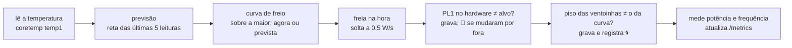

# Como o termostato funciona

Este documento acompanha o caminho inteiro: do arquivo de configuração até o registro dentro da CPU.

## A ideia em uma frase

**A CPU nunca fica solta.** No dia a dia ela trabalha sob o **limite normal** (PL1 de 38 W). Quando a temperatura sobe, ou quando a **previsão** mostra que vai subir, a **curva de freio** baixa o PL1 aos poucos, até 25 W em 92 °C. A arrancada curta (o turbo até 3,4 GHz) continua livre, porque quem a governa é o PL2, que o termostato não toca.

## Os módulos

| Arquivo | Papel |
|---|---|
| [`src/main.rs`](../src/main.rs) | O laço a cada `intervalo_s`, o servidor HTTP do `/metrics`, os sinais e o `--desinstalar` |
| [`src/config.rs`](../src/config.rs) | Lê e valida o `/etc/termostato.toml`; arquivo ausente = padrões |
| [`src/freio.rs`](../src/freio.rs) | A regra do freio de calor, pura (sem hardware), com histerese |
| [`src/sopro.rs`](../src/sopro.rs) | A curva das ventoinhas, pura (sem hardware): segue a temperatura média, desce devagar |
| [`src/hardware.rs`](../src/hardware.rs) | Sensor, RAPL, ventoinhas e frequência, pelo sysfs |
| [`src/fabrica.rs`](../src/fabrica.rs) | Os valores de fábrica, gravados uma vez, para o `--desinstalar` |
| [`src/metricas.rs`](../src/metricas.rs) | O retrato de cada leitura e o texto do Prometheus |

Dependências: `serde` e `toml` (configuração), `signal-hook` (SIGTERM e SIGINT). O HTTP e o formato do Prometheus são escritos à mão, com a biblioteca padrão, porque são poucas linhas e evitam um runtime assíncrono inteiro num serviço que responde a um pedido a cada 5 s.

## O laço

A cada 2 s (`intervalo_s`):



Regravar a cada volta é deliberado. Outro programa pode mudar o PL1 por fora; o `thermald` fazia isso a cada 2 s (ver [decisões](decisoes.md)). O termostato corrige em uma volta e deixa o rastro no journal.

## A curva de freio, com previsão do pico

Até a 0.3, o freio era liga-desliga e **reagia**: só agia depois de 5 leituras (10 s) acima de 92 °C. A medição de 19/11/2026 mostrou que os picos de 99–100 °C acontecem na arrancada, nos primeiros segundos de carga cheia, antes de o freio reagir. A 0.4 freia **antes**.

### 1. Previsão

Uma reta de mínimos quadrados pelas últimas `janela_leituras` temperaturas (5 leituras = 10 s) dá a **tendência**, em °C/s. A temperatura prevista é:

```
prevista = agora + max(tendência, 0) × previsao_s     (previsao_s = 10 s)
```

Só a subida projeta: esfriando, vale a temperatura de agora, porque esfriar não é motivo para soltar mais cedo.

Exemplo do teste `freia_antes_do_pico_pela_previsao`: a CPU em 78 °C subindo 1,2 °C/s prevê 90 °C em 10 s. A curva já freia para ~28 W, quando a regra antiga nem teria começado a contar.

### 2. A curva

```
PL1 (W)
 38 ┤━━━━━━━━━━━━━━━━━┓
    │                  ┗━┓
    │                     ┗━┓          reta entre os dois pontos
 31,5┤                       ┗━┓  ← 86 °C
    │                           ┗━┓
 25 ┤                              ┗━━━━━━━━━━━━
    └──────────────────┬───────────┬──────────── °C (agora ou prevista, a maior)
                      80          92
                 freio_comeca_c  freio_acima_c
```

A curva é aplicada à **maior** entre a temperatura de agora e a prevista.

### 3. Freia rápido, solta devagar

- Se a curva pede um PL1 **menor** que o atual, ele vale na hora.
- Se pede **maior**, o PL1 sobe no máximo `subida_w_por_s` (0,5 W/s): de 25 W a 38 W leva 26 s.

Isso substitui a histerese do freio antigo. Sem calor novo, o freio vai soltando aos poucos; se o calor volta no meio da subida, a curva freia de novo na hora. Não há efeito sanfona.

### 4. O alvo (`termostato CPU50C`)

Com `alvo_c` acima de 0, um controle **integral** trabalha junto com a curva:

- Acima do alvo (a temperatura de **agora**), o PL1 do alvo desce `alvo_ganho_w_por_c_s` × erro por segundo: 10 °C acima, com o ganho 0,5, são 5 W/s.
- Abaixo do alvo, sobe no máximo `subida_w_por_s`, como o freio.
- Fica entre `pl1_minimo_w` (8 W) e `pl1_normal_w`. Vale o **menor** entre ele e a curva, então a curva continua mandando quando freia mais (a 92 °C, 25 W de uma vez).

O alvo não usa a previsão, que fica com a curva. Na medição de 19/11/2026, com o build do VintageLightbox na VM Windows e `CPU65C`, a previsão fazia o controle se assustar com os picos curtos do Haswell: a CPU ficava em 57–66 °C, abaixo do alvo, e o PL1 caía a 8 W num tranco. Sem ela, ficou em 60–69 °C, em volta dos 65, com o PL1 estável entre 14 e 21 W.

O piso de 8 W tem limite físico. Com `CPU50C` e o build na VM, a CPU ficou em 51–62 °C. Parada, ela já fica em ~48 °C, e a arrancada curta (PL2) segue livre.

É integral, e não uma segunda curva, porque o PL1 que segura 50 °C depende da carga: 20 W numa build, 10 W num `rustc` sozinho. A curva fixa erraria para um lado ou para o outro; o integral acha o valor sozinho e o acompanha quando a carga muda.

### Estados no journal

- 🔥 quando o PL1 sai do limite normal, com a temperatura de agora, a prevista e a tendência. Exemplo: `🔥 78 °C agora, 90 °C previstos em 10 s (+1.2 °C/s): freio de calor acionado, PL1 em 28.3 W`.
- 🎯 quando é o alvo que aciona o freio: `🎯 58 °C, acima do alvo de 50 °C: freio acionado, PL1 em 34.0 W`.
- ❄️ quando volta ao limite normal.
- 🎛️ quando um ajuste (`termostato chave=valor`) entra em vigor: `🎛️ ajuste: alvo_c = 50.0`.

A regra está em [`freio.rs`](../src/freio.rs), sem nenhum acesso a hardware, e é testada leitura a leitura com tempo simulado.

## Do arquivo ao registro da CPU

O termostato não escreve em registros diretamente. Ele grava nos arquivos que os **drivers do kernel** expõem em `/sys`, e cada driver traduz a gravação para o hardware:

| Controle | O termostato grava | O driver | O hardware |
|---|---|---|---|
| Limite de potência (PL1) | `/sys/class/powercap/intel-rapl:0/constraint_0_power_limit_uw` | `intel_rapl` | registro **MSR 0x610** (`MSR_PKG_POWER_LIMIT`) da CPU |
| Piso das ventoinhas | `/sys/class/hwmon/hwmonN/fanK_min` | `applesmc` | chaves **F0Mn / F1Mn** do SMC, o controlador de ventoinhas da Apple |

E o que ele lê:

| Leitura | Arquivo | De onde vem |
|---|---|---|
| Temperatura | `hwmonN/temp1_input` do `coretemp` | sensor digital do pacote (MSR 0x1B1) |
| Potência | `intel-rapl:0/energy_uj` | contador de energia do chip (MSR 0x611) |
| Frequência | `cpuN/cpufreq/scaling_cur_freq` | `intel_cpufreq` |
| Ventoinhas | `fanK_input`, `fanK_min`, `fanK_max` | SMC, pelo `applesmc` |

O número de cada `hwmonN` muda entre boots, então os chips são achados pelo arquivo `name` (`coretemp`, `applesmc`), nunca por caminho fixo.

### A prova, lida no chip

Em 19/11/2026, com o termostato rodando, o registro lido direto da CPU (`/dev/cpu/0/msr`) estava assim:

```
MSR 0x610 = 0x004383e800dd8130
  PL1: 0x130 = 304 unidades × 1/8 W = 38,0 W   (bit 15: ligado)
  PL2: 0x3e8 = 1000 unidades × 1/8 W = 125,0 W  (bit 47: ligado)
MSR 0x1A2 (TjMax) = 100 °C
```

A unidade de potência (1/8 W) vem do `MSR 0x606`. Os 38 W pedidos pelo termostato estão no registro que o circuito de gerenciamento de energia da CPU consulta continuamente.

### Por que pelo driver, e não direto no registro

- **O driver valida:** confere a unidade de potência do chip, recusa valores fora da faixa e respeita o bit de trava do registro. Uma escrita direta errada no MSR 0x610 pode desligar o limite ou travá-lo até o próximo boot.
- **Funciona com Secure Boot:** com o kernel em modo lockdown, a escrita direta em MSR é bloqueada; o caminho pelo driver continua valendo.
- **O efeito é o mesmo bit a bit.**

## Parar sem abrir buraco

Ao receber SIGTERM ou SIGINT, o termostato **não** devolve os valores de fábrica. Ele grava o PL1 do limite normal (se o freio estava acionado, sai dos 25 W para os 38 W) e deixa as ventoinhas como estão.

O motivo: um reinício (`systemctl restart`, atualização, crash com `Restart=always`) que voltasse o PL1 aos 100 W de fábrica deixaria a máquina sem limite por alguns segundos, justo quando ela costuma estar compilando. Isso aconteceu na 0.1.0, e a CPU chegou a 96 °C durante uma reinstalação.

Os valores de fábrica só voltam pelo `termostato --desinstalar`, chamado pelo `desinstalar.sh`.

## Os valores de fábrica

Ficam em `/var/lib/termostato/fabrica.toml` (o `StateDirectory` do serviço) e são gravados **só na primeira subida**. Depois disso o hardware já tem os valores do termostato, e ler de novo guardaria os 38 W como se fossem de fábrica.

Numa máquina em que o PL1 já tinha sido mexido antes da primeira subida, o `instalar.sh` semeia o arquivo com o PL1 do firmware da Apple (100 W). Os pisos das ventoinhas de fábrica não eram conhecidos nesse caso e ficaram de fora: na desinstalação elas continuam no máximo até o próximo desligamento completo, quando o SMC volta ao automático.

## O `/metrics` e o `/saude`

- Uma thread com `std::net::TcpListener` em `127.0.0.1:9101`. Ela lê o pedido até o fim do cabeçalho antes de responder: responder no primeiro pedaço e fechar com o resto por ler faz o kernel mandar RST (defeito pego pelo teste na primeira versão).
- `/metrics`: o formato de texto do Prometheus. Métrica sem leitura some, em vez de mentir zero.
- `/saude`: 200 com leitura nos últimos 3 intervalos, 503 sem.
- O laço guarda o retrato da última leitura num `Arc<Mutex<…>>`; o HTTP só lê esse retrato e nunca toca o hardware.

## O serviço no systemd

[`termostato.service`](../termostato.service):

- `Restart=always`, `RestartSec=3`: volta sozinho, e graças à parada segura não há janela sem limite.
- `After=tuned.service thermald.service`: sobe depois deles, para os valores que valem serem os seus.
- Roda como root, mas trancado: `ProtectSystem=strict` deixa o sistema inteiro só para leitura, com `ReadWritePaths=/sys` e o `StateDirectory=termostato` como exceções. Também `ProtectHome`, `PrivateTmp` e `NoNewPrivileges`.
- `/metrics` só no loopback: o Prometheus lê, e mais ninguém na rede.

## Os testes

28 testes, todos rodando sem root e sem MacBook: [`hardware::sysfs_de_teste`](../src/hardware.rs) monta numa pasta temporária um sysfs de mentira com o que o MacBookPro11,2 tem (um `hwmon` de outro chip na frente, para provar a busca pelo nome; o `coretemp`; o `applesmc` com duas ventoinhas; o RAPL; quatro núcleos). Os casos cobrem:

- a curva de freio: a previsão pela reta, a curva entre os dois pontos, frear na hora e soltar a 0,5 W/s, calor de novo no meio da volta, e esfriar sem prever para baixo;
- a configuração (padrões, campo com erro de digitação, valores recusados);
- a regravação do PL1 mudado por fora;
- a parada segura (sai com 38 W, nem 25 nem 100);
- o `--desinstalar` (devolve a fábrica e apaga o estado);
- o HTTP de verdade (`/metrics`, `/saude` 200 e 503, 404);
- o contador de energia que dá a volta.
